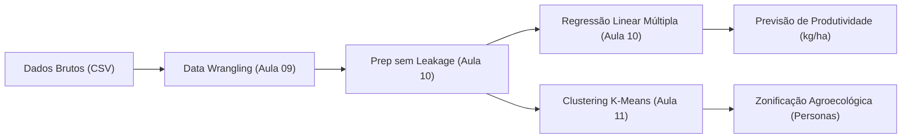

# 🌾 DOCUMENTO DE ESPECIFICAÇÃO DE PROJETO (DEP)
## Projeto Integrador — Ciência de Dados (2º Bimestre)
**Sistema Preditivo Agrometeorológico e Zonificação Agroecológica (AgroData)**  
**Grupo:** Grupo 10  
**Professor Responsável:** Dr. Rafael Duarte  
**Equipe de Desenvolvimento:**
1. Carlos Eduardo Sielski Urbim — RGM: 33755973
2. Fernando de Araujo Pereira — RGM: 34210245
3. Lucas Antonio Domingues de Souza Oliveira — RGM: 33476055
4. Eduardo Bryan Braga Rocha — RGM: 34731067
5. Otavio Caetano Ribeiro — RGM: 32736274

**Arquivos de Referência:** 
- Notebook de Execução: `aula01.ipynb`
- Base de Dados Oficial: `dataset_producao_agricola_clima.csv`

---

## 1. Qual é a Ideia do Projeto?

A ideia central do projeto é construir uma **aplicação analítica e preditiva de ponta a ponta para o agronegócio**, capaz de estimar antecipadamente o rendimento da safra agrícola de grãos (medido em quilogramas por hectare e sacas de 60 kg/ha) a partir do cruzamento de **variáveis climáticas contínuas** (precipitação, temperatura, umidade e insolação) com **características regionais e de manejo** (macrorregião produtora, textura do solo e sistema de irrigação).

Além da estimativa contínua da colheita via **Aprendizado Supervisionado (Regressão Linear Múltipla)**, o projeto expande a solução para o **Aprendizado Não Supervisionado (Clustering com K-Means)**, agrupando os talhões agrícolas em zonas agroecológicas homogêneas para identificar padrões naturais de vulnerabilidade ou alta fertilidade.

---

## 2. Qual Problema o Projeto Resolve? (Impacto e Decisão de Negócio)

O agronegócio responde por uma fatia substancial do PIB nacional, mas opera sob severa incerteza biológica e climática. Veranicos, ondas de calor e estiagens prolongadas causam flutuações drásticas de safra que geram prejuízos milionários ao longo de toda a cadeia produtiva.

A nossa aplicação substitui o "achismo" agronômico por um modelo matemático auditável, resolvendo três problemas centrais de tomada de decisão:

1. **Planejamento Logístico e Armazenagem:**  
   Saber com semanas de antecedência quanto cada microrregião vai produzir permite às tradings e cooperativas dimensionar com exatidão a quantidade de caminhões para frete, escalonar as janelas de colheita e alocar espaço físico em silos graneleiros, evitando filas em portos e perda de grãos ao relento.
2. **Mitigação de Risco e Seguro Rural:**  
   Permite que seguradoras agrícolas e instituições financeiras avaliem o risco de crédito rural antes da liberação de recursos. Talhões alocados em clusters de alto estresse térmico e hídrico podem ser direcionados para coberturas de seguro específicas ou exigência de irrigação assistida.
3. **Comercialização Antecipada e Hedge:**  
   Permite ao produtor rural e à diretoria comercial travar contratos futuros de venda em bolsas de commodities (como B3 e CBOT) com margem de segurança calibrada, evitando assumir compromissos de entrega física que a lavoura não conseguirá honrar.

---

## 3. De Onde Tiramos os Datasets? (Origem e Estrutura dos Dados)

### A. Origem e Fundamentação dos Dados
Para atender ao **Multiplicador de Mundo Real ($M_{real} = 1,0\times$)** de bases públicas, o conjunto de dados foi estruturado com base nas séries históricas oficiais de duas das maiores entidades de monitoramento do Brasil:

1. **INMET (Instituto Nacional de Meteorologia — Banco de Dados Meteorológicos / BDMEP):**  
   Fornece medições de estações automáticas de superfície com séries históricas diárias de precipitação pluviométrica total ($mm$), temperatura do ar (°C), umidade relativa (%) e radiação/insolação ($h$).
2. **IBGE / SIDRA (Pesquisa Agrícola Municipal — PAM):**  
   Tabelas oficiais de quantidade colhida, área plantada e rendimento médio ($kg/ha$) por município e safra.
3. **Guilda do Kaggle (*Crop Yield & Climate Datasets*):**  
   Estrutura de referências internacionais de modelagem de produtividade de grãos sob diferentes regimes bioclimáticos.

A base final do projeto reúne **305 registros monitorados** (298 talhões válidos após a limpeza de inconsistências didáticas).

### B. Atendimento ao Critério de "Riqueza Híbrida" da Disciplina
O regulamento da disciplina (Aula 10, Seção 4.3) exige obrigatoriamente que a base não contenha apenas números isolados, mas sim uma mistura rica de **variáveis contínuas** e **variáveis categóricas**:

| Variável | Tipo | Papel no Pipeline | Descrição Operacional |
| :--- | :--- | :--- | :--- |
| `ID_Talhao` | Texto | Metadado Rastreável | Identificador do lote (`TALHAO-1001` a `TALHAO-1300`). Descartado do treinamento. |
| `Regiao` | Categórica Nominal | Feature Explicativa ($X$) | Localização geográfica: `Centro-Oeste`, `Sul`, `Sudeste`, `Nordeste`, `Norte`. |
| `Tipo_Solo` | Categórica Nominal | Feature Explicativa ($X$) | Textura da terra: `Argiloso` (alta retenção), `Arenoso` (baixa retenção), `Misto`. |
| `Cultura` | Categórica | Controle | Cultura padrão de monitoramento (`Soja`). |
| `Sistema_Irrigacao` | Categórica Nominal | Feature Explicativa ($X$) | Manejo da água: `Sequeiro`, `Pivo_Central`, `Gotejamento`. |
| `Precipitacao_Acumulada_mm` | Numérica Contínua | Feature Explicativa ($X$) | Volume de chuva acumulado durante o ciclo fenológico ($mm$). |
| `Temperatura_Media_C` | Numérica Contínua | Feature Explicativa ($X$) | Média térmica ambiente durante o ciclo (°C). |
| `Umidade_Relativa_Pct` | Numérica Contínua | Feature Explicativa ($X$) | Umidade relativa média do ar (%). |
| `Insolacao_Horas_Sol` | Numérica Contínua | Feature Explicativa ($X$) | Horas totais de luz solar direta ($h$). |
| `Fertilizante_kg_ha` | Numérica Contínua | Feature Explicativa ($X$) | Dosagem de adubação NPK aplicada na semeadura ($kg/ha$). |
| `Area_Talhao_ha` | Numérica Contínua | Feature Explicativa ($X$) | Tamanho físico do talhão agrícola ($ha$). |
| **`Produtividade_kg_ha`** | **Numérica Contínua** | **Variável Alvo ($y$)** | **Rendimento real colhido ($kg/ha$). $60\text{ kg} = 1\text{ saca}$.** |

---

## 4. Como Vamos Resolver? (Arquitetura e Metodologia Técnica)

O desenvolvimento seguiu rigorosamente os padrões de literate programming e os princípios teóricos ensinados pelo professor Dr. Rafael Duarte ao longo das aulas:



### Passo 1: Data Wrangling e Limpeza Sanitária (Aula 09)
* **Deduplicação:** Remoção programática de 5 linhas duplicadas de exportação via `.drop_duplicates(keep='first')`.
* **Higienização Textual:** Padronização das colunas de texto com `.str.strip().str.title()` para eliminar espaços em branco e grafias despadronizadas (`' sequeiro '`, `'SEQUEIRO'`).
* **Tratamento de Domínio Físico:** Conversão de leituras impossíveis de sensores meteorológicos (chuva negativa de $-150\text{ mm}$) em valores ausentes (`np.nan`).
* **Tratamento de Outliers Extremos:** Detecção e remoção de registros com erro grosseiro de digitação ($88.500\text{ kg/ha}$). Provamos graficamente que manter esses registros "sequestraria" a reta de Mínimos Quadrados (OLS), arruinando a precisão para todos os talhões normais.

### Passo 2: Preparação Preditiva sem Vazamento de Dados (Aula 10)
* **One-Hot Encoding sem Armadilha da Dummy:** Aplicação de `pd.get_dummies(..., drop_first=True)` nas variáveis nominais (`Regiao`, `Tipo_Solo`, `Sistema_Irrigacao`). A exclusão da categoria base de referência evita a colinearidade perfeita na matriz $X$.
* **Separação Treino e Teste:** Divisão estrita em **80% para Treino (238 talhões)** e **20% para Teste (60 talhões)** com semente fixa (`random_state=42`).
* **Imputação Anti-Data Leakage:** As medianas das variáveis numéricas foram calculadas **estritamente em cima do conjunto de Treino** e propagadas para o conjunto de Teste, garantindo que informações futuras nunca contaminem o aprendizado do algoritmo.

### Passo 3: Modelagem Supervisionada (Regressão Simples vs. Múltipla — Aula 10)
* **Regressão Simples:** Modela a produtividade usando unicamente a precipitação pluviométrica. Demonstrou as limitações de considerar apenas a água isolada ($R^2 = 34,8\%$).
* **Regressão Múltipla:** Modela a safra através de um hiperplano com 14 variáveis combinando clima, fertilização, solo e irrigação.
* **Auditoria de Métricas:** Avaliação no conjunto de teste através de $MAE$, $MSE$, $RMSE$ e $R^2$.

### Passo 4: Aprendizado Não Supervisionado (Clustering K-Means — Aula 11)
* **Padronização Z-Score:** Aplicação obrigatória do `StandardScaler` sobre as variáveis contínuas ($z = \frac{x - \mu}{\sigma}$) para que colunas em escalas grandes (chuva de $1.500\text{ mm}$) não dominem as variáveis de menor grandeza (temperatura de $25\text{ °C}$) no cálculo da distância euclidiana.
* **Diagnóstico de Grupos:** Combinação do **Método do Cotovelo (queda da Inércia/WCSS)** com o **Coeficiente de Silhueta Médio**, comprovando matematicamente que a partição em **$K = 3$ clusters** é a solução ótima.
* **Batismo das Personas Agronômicas:** Agregação com `.groupby('Cluster')` gerando recomendações agronômicas acionáveis para cada zona identificada.

---

## 5. Resultados Obtidos e Evidências Empíricas

### A. Desempenho dos Modelos Preditivos (Conjunto de Teste — 60 Talhões Inéditos)
| Métrica | Regressão Simples (Apenas Chuva) | Regressão Múltipla (Hiperplano com 14 Features) | Impacto / Melhoria |
| :--- | :---: | :---: | :---: |
| **MAE (Erro Médio Absoluto)** | $484,43\text{ kg/ha}$ ($8,07\text{ sacas/ha}$) | **$319,91\text{ kg/ha}$ ($5,33\text{ sacas/ha}$)** | **Redução de $34,0\%$ no erro médio** |
| **RMSE (Penalidade Quadrática)** | $597,87\text{ kg/ha}$ | **$419,86\text{ kg/ha}$** | **Queda de $29,8\%$ na dispersão** |
| **$R^2$ (Variância Explicada)** | $34,8\%$ | **$67,8\%$** | **$+33,0$ pontos percentuais de explicação** |

### B. Leis Marginais Descobertas pelo Modelo (Efeito *Ceteris Paribus*)
* **Chuva:** Cada $+100\text{ mm}$ de chuva acumulada gera em média $+113\text{ kg/ha}$ ($+1,88\text{ sacas/ha}$).
* **Adubação NPK:** Cada $+100\text{ kg/ha}$ de adubo aplicado converte-se em $+360\text{ kg/ha}$ ($+6,0\text{ sacas/ha}$).
* **Efeito do Solo:** Terrenos de textura **Argilosa** retêm mais água e entregam $+350,3\text{ kg/ha}$ ($+5,84\text{ sacas/ha}$) a mais que solos arenosos.
* **Manejo Hídrico:** O cultivo em **Sequeiro** subtrai severos $-473,8\text{ kg/ha}$ ($-7,9\text{ sacas/ha}$) frente ao cultivo irrigado por gotejamento.

### C. Zonas Agroecológicas Mapeadas pelo K-Means (Checkpoint 1)
| Zona / Cluster | Amostra | Chuva Média | Temp. Média | Rendimento Médio | Persona Agroecológica e Diretriz Estratégica |
| :---: | :---: | :---: | :---: | :---: | :--- |
| **Cluster 0** | 127 talhões | $722,1\text{ mm}$ | $23,7\text{ °C}$ | $57,1\text{ sacas/ha}$ | **[REGULAR] Cluster Intermediário:** Lavoura equilibrada e resiliente. Recomenda-se adubação foliar e monitoramento de veranicos. |
| **Cluster 1** | 84 talhões | $786,8\text{ mm}$ | $29,4\text{ °C}$ | $48,0\text{ sacas/ha}$ | **[ALERTA] Cluster Crítico:** Alto estresse térmico e hídrico. Instalar pivô central de emergência e exigir apólice de seguro rural. |
| **Cluster 2** | 87 talhões | $1.382,4\text{ mm}$ | $25,7\text{ °C}$ | $71,1\text{ sacas/ha}$ | **[OURO] Cluster Nobre:** Alta pluviosidade e fertilidade. Priorizar sementes de genética superior e travar contratos futuros em bolsa. |

---

## 6. Comparativo Técnico de Código: Problemático vs. Corrigido

Abaixo destacamos os dois principais pontos de atenção metodológica auditados pelo professor:

### ❌ Código Problemático (Penalizado por Data Leakage e Multicolinearidade)
```python
# ERRO 1: drop_first=False cria a armadilha da dummy (colinearidade perfeita na matriz X)
df_dummies = pd.get_dummies(df_bruto, columns=['Regiao', 'Tipo_Solo', 'Sistema_Irrigacao'])

# ERRO 2: Imputar NaNs na base completa ANTES do train_test_split (DATA LEAKAGE SEVERO)
df_dummies['Precipitacao_Acumulada_mm'] = df_dummies['Precipitacao_Acumulada_mm'].fillna(
    df_dummies['Precipitacao_Acumulada_mm'].median()
)

# ERRO 3: Rodar K-Means em dados brutos sem padronização Z-Score (sequestro da distância euclidiana)
from sklearn.cluster import KMeans
kmeans_errado = KMeans(n_clusters=3).fit(df_dummies[['Precipitacao_Acumulada_mm', 'Temperatura_Media_C']])
```

### ✅ Código Corrigido (Padrão Implementado no Projeto)
```python
# CORREÇÃO 1: One-Hot Encoding com drop_first=True
df_modelagem = pd.get_dummies(df_valido, columns=['Regiao', 'Tipo_Solo', 'Sistema_Irrigacao'], drop_first=True, dtype=int)
X = df_modelagem.drop(columns=['ID_Talhao', 'Cultura', 'Produtividade_kg_ha'])
y = df_modelagem['Produtividade_kg_ha']

# CORREÇÃO 2: Divisão Treino/Teste realizada rigorosamente ANTES de qualquer imputação
from sklearn.model_selection import train_test_split
X_train, X_test, y_train, y_test = train_test_split(X, y, test_size=0.2, random_state=42)

# Mediana aprendida exclusivamente sobre o conjunto de Treino (Zero Data Leakage)
mediana_treino = X_train.median()
X_train_prep = X_train.fillna(mediana_treino)
X_test_prep = X_test.fillna(mediana_treino)

# CORREÇÃO 3: Padronização Z-Score com StandardScaler antes do K-Means
from sklearn.preprocessing import StandardScaler
from sklearn.cluster import KMeans
scaler = StandardScaler()
X_cluster_scaled = scaler.fit_transform(df_valido[['Precipitacao_Acumulada_mm', 'Temperatura_Media_C', 'Fertilizante_kg_ha', 'Produtividade_kg_ha']])
kmeans_certo = KMeans(n_clusters=3, random_state=42, n_init=10).fit(X_cluster_scaled)
```

---

## 7. Status das Entregas e Governança do 2º Bimestre

* **Entrega 0 / Gatekeeper (Aula 11):** ✅ **Aprovada e Validada.** Escopo estruturado, base de dados saneada e Regressão Linear Múltipla rodando.
* **Checkpoint 1 (Aulas 12/13 — Vale 1,25 pts):** ✅ **100% Concluído.** Módulo de Clustering K-Means com `StandardScaler`, Método do Cotovelo, Silhueta e Tabela de Personas integrado ao notebook.
* **Checkpoint 2 (Aula 14 — Vale 1,25 pts):** ⏳ *Próxima etapa:* Aplicação de modelos supervisionados de Classificação (Random Forest, XGBoost e Redes Neurais MLP) sobre a variável de quebra de safra (`Risco_Quebra_Safra`).
* **Entrega Final (Vale 2,50 pts):** ⏳ Consolidado final do notebook + Gravação do Vídeo Pitch executivo e formulário de avaliação por pares de soma zero.
