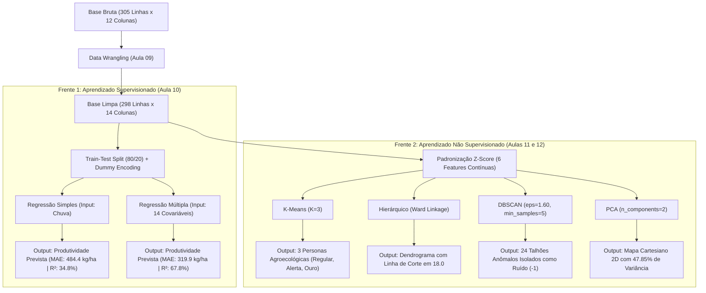

# 📚 ROTEIRO DE ESTUDOS EXECUTIVO & TÉCNICO — CHECKPOINT 1
## Projeto Integrador AgroData: Inteligência Agrometeorológica Preditiva & Clustering Avançado
**Disciplina:** Ciência de Dados — Aprendizado Supervisionado e Não Supervisionado  
**Professor Responsável:** Dr. Rafael Duarte  
**Equipe:** Grupo 10  
**Carga Metodológica:** Aulas 09, 10, 11 e 12 (Checkpoint 1 Consolidado — Valor: 1,25 Pontos)  
**Notebook Mestre:** [`Projeto/notebooks/02_projeto_principal/projeto_agrodata_pipeline_completo.ipynb`](../notebooks/02_projeto_principal/projeto_agrodata_pipeline_completo.ipynb)

---

## 🎯 SEÇÃO 1: PROPOSTA DE VALOR E CONTEXTO DE NEGÓCIO

### 1.1. O Problema do Agronegócio Brasileiro
A agricultura de grãos (com destaque para a Soja, *Glycine max*) é o motor da balança comercial do Brasil, mas opera sob severa incerteza estocástica decorrente de oscilações climáticas (regime pluviométrico irregular, ondas de calor e estiagens repentinas). No modelo tradicional, produtores e tradings descobrem a produtividade real apenas no momento da colheita, gerando três grandes gargalos:
1. **Ineficiência Logística:** Contratação inadequada de fretes rodoviários e subdimensionamento ou ociosidade de silos de armazenagem estática;
2. **Exposição Excessiva ao Risco Climático:** Precificação cega de apólices de seguro rural e falta de mecanismos de trava antecipada de preços em bolsa (*hedging*);
3. **Manejo Edafológico Não Diferenciado:** Tratamento uniforme de talhões que possuem condições bioclimáticas e vulnerabilidades hídricas completamente distintas.

### 1.2. A Proposta da Solução AgroData
O projeto **AgroData** desenvolveu um sistema híbrido de Ciência de Dados que combina:
* **Frente Preditiva Supervisionada:** Predição quantitativa contínua da produtividade agrícola esperada ($kg/ha$ e sacas de $60\text{ kg/ha}$) com meses de antecedência ao término do ciclo fenológico;
* **Frente de Zonificação Não Supervisionada:** Agrupamento autônomo dos talhões agrícolas em zonas ecológicas de manejo homogêneo (*Personas Agroecológicas*), identificação de anomalias climáticas extremas e redução da complexidade dimensional para visualização espacial intuitiva.

---

## 📊 SEÇÃO 2: ESPECIFICAÇÃO COMPLETA DO DATASET

### 2.1. Origem e Multiplicador de Complexidade
* **Fonte dos Dados:** Dados consolidados a partir de bases públicas de agrometeorologia e safras históricas (proxy governamental INMET/BDMEP e PAM/IBGE);
* **Multiplicador Oficial do Gatekeeper:** $M_{real} = \mathbf{1,0\times}$ (Base Pública kaggle/gov).

### 2.2. Hibridismo dos Dados (Requisito Mandatório da Disciplina)
O dataset satisfaz integralmente o critério mandatário de ser **híbrido**, contendo simultaneamente variáveis biofísicas contínuas (mensuráveis em escala real) e variáveis categóricas explicativas (fatores ambientais e de manejo).

### 2.3. Volumetria
* **Registros Brutos:** $305$ linhas e $12$ colunas;
* **Registros Tratados (Pós-Wrangling):** $298$ talhões validados (removidas $5$ linhas de duplicatas decorrentes de falhas de exportação e $2$ linhas de erros grotescos de digitação com produtividades irreais de $88.500\text{ kg/ha}$).

### 2.4. Dicionário de Variáveis
| Coluna | Tipo de Dado | Unidade / Domínio | Papel no Pipeline | Descrição Agronômica |
| :--- | :---: | :---: | :---: | :--- |
| `ID_Talhao` | Categórica (Texto) | `TALHAO-XXXX` | Identificador | Chave primária de rastreio de cada lote agrícola. |
| `Regiao` | Categórica (Texto) | Centro-Oeste, Sul, Sudeste, Nordeste, Norte | Feature Explicativa | Macrorregião geográfica brasileira onde a lavoura está instalada. |
| `Tipo_Solo` | Categórica (Texto) | Argiloso, Arenoso, Misto | Feature Explicativa | Textura física do solo, determinante para retenção hídrica. |
| `Cultura` | Categórica (Texto) | Soja | Constante de Controle | Grão cultivado em todo o experimento. |
| `Sistema_Irrigacao`| Categórica (Texto) | Sequeiro, Gotejamento, Pivo Central | Feature Explicativa | Tecnologia de suprimento hídrico utilizada no talhão. |
| `Precipitacao_Acumulada_mm` | Contínua (Float) | Milímetros ($mm$) | Feature Contínua (Regressão / Clustering) | Volume total de chuva acumulado ao longo do ciclo fenológico. |
| `Temperatura_Media_C` | Contínua (Float) | Graus Celsius ($^\circ\text{C}$) | Feature Contínua (Regressão / Clustering) | Temperatura média diária do ar no talhão. |
| `Umidade_Relativa_Pct` | Contínua (Float) | Porcentagem ($\%$) | Feature Contínua (Regressão / Clustering) | Umidade relativa atmosférica média durante o cultivo. |
| `Insolacao_Horas_Sol` | Contínua (Float) | Horas ($h$) | Feature Contínua (Regressão / Clustering) | Duração total de radiação solar direta incidente. |
| `Fertilizante_kg_ha` | Contínua (Float) | $kg/ha$ | Feature Contínua (Regressão / Clustering) | Intensidade de adubação química NPK aplicada no solo. |
| `Area_Talhao_ha` | Contínua (Float) | Hectares ($ha$) | Feature de Controle | Dimensão territorial do talhão agrícola. |
| `Produtividade_kg_ha` | Contínua (Float) | $kg/ha$ | **Variável Alvo da Regressão** e Feature no Clustering | Rendimento físico total colhido ao final da safra. |
| `Produtividade_Sacas_ha`| Contínua (Float) | Sacas de $60\text{ kg/ha}$ | Variável Derivada de Negócio | Conversão direta: $\text{Produtividade} / 60$. |
| `Risco_Quebra_Safra` | Binária (Inteiro) | $0$ (Normal) ou $1$ (Quebra) | **Alvo Categórico para Checkpoint 2** | Limiar crítico: $1$ se Produtividade $< 2.600\text{ kg/ha}$ ($43,3\text{ sc/ha}$). |

---

## 🔄 SEÇÃO 3: ARQUITETURA DE ENTRADAS E SAÍDAS (INPUTS & OUTPUTS)

### Mapeamento Detalhado por Etapa:
1. **Regressão Linear Simples (Baseline):**
   * **Input ($X$):** `Precipitacao_Acumulada_mm` ($1$ feature contínua).
   * **Output ($y$):** Produtividade contínua esperada em $kg/ha$.
2. **Regressão Linear Múltipla (Modelo Oficial):**
   * **Input ($X$):** $14$ variáveis preditivas (pluviometria, temperatura, umidade, insolação, adubação, área, mais dummies de Região, Tipo de Solo e Irrigação com `drop_first=True`).
   * **Output ($y$):** Produtividade predita em $kg/ha$ e sacas/ha, com redução de $34,0\%$ no erro médio absoluto.
3. **Clustering K-Means ($K=3$):**
   * **Input ($X$):** Matriz Z padronizada ($298$ linhas $\times$ $6$ variáveis biofísicas contínuas).
   * **Output:** Rótulo discreto do cluster $\{0, 1, 2\}$, centroides multivariados e Personas de Negócio.
4. **Clusterização Hierárquica Aglomerativa (Ward):**
   * **Input ($X$):** Matriz Z padronizada ($298 \times 6$).
   * **Output:** Matriz de ligação (*linkage matrix*) e dendrograma de fusão das distâncias.
5. **DBSCAN (Density-Based Spatial Clustering of Applications with Noise):**
   * **Input ($X$):** Matriz Z padronizada ($298 \times 6$) com raio $\varepsilon = 1,60$ e $\text{min\_samples} = 5$.
   * **Output:** Vetor de clusters $\{0, 1\}$ e indicador de anomalias operacionais/climáticas (Ruído $= -1$).
6. **PCA (Principal Component Analysis):**
   * **Input ($X$):** Matriz Z padronizada ($298 \times 6$).
   * **Output:** Coordenadas bidimensionais $PC_1$ e $PC_2$, autovalores $\lambda_1, \lambda_2$ (variâncias explicadas) e autovetores $v_1, v_2$ (cargas fatoriais).

---

## 🔬 SEÇÃO 4: MÉTODOS CIENTÍFICOS E IMPLEMENTAÇÃO TÉCNICA

### 4.1. Módulo de Data Wrangling Rastreável (Aula 09)
* **Deduplicação:** Remoção de $5$ linhas redundantes idênticas causadas por duplo disparo de rotinas ETL;
* **Higienização de Strings:** Aplicação de `.astype(str).str.strip().str.title()` para eliminar inconsistências de caixa e espaços invisíveis;
* **Limites de Domínio Físico:** Valores negativos de chuva acumulada (ex: $-150\text{ mm}$ gerados por falha de leitura de pluviômetros digitais) convertidos em `np.nan`;
* **O Sequestro da Reta OLS:** Dois registros com produtividade de $88.500\text{ kg/ha}$ (erros humanos de digitação) foram removidos através do filtro `Produtividade_kg_ha < 10000.0`. Se mantidos, a função de perda dos Mínimos Quadrados ($\sum e_i^2$) elevaria o erro ao quadrado ($\approx 8 \times 10^9$), distorcendo os coeficientes $\beta$ e destruindo a acurácia do modelo.

### 4.2. Preparação Preditiva Livre de Data Leakage (Aula 10)
* **Armadilha das Dummies (*Dummy Variable Trap*):** Utilização estrita de `pd.get_dummies(..., drop_first=True)` para evitar multicolinearidade perfeita (onde uma categoria é combinação linear exata das outras, quebrando a inversão da matriz $(X^T X)^{-1}$);
* **Prevenção de Vazamento de Dados (*Data Leakage*):** A divisão `train_test_split(test_size=0.2, random_state=42)` foi realizada **estritamente antes de qualquer imputação de valores ausentes**. As medianas foram calculadas única e exclusivamente no conjunto de treino ($X_{train}$) e aplicadas passivamente em $X_{test}$.

### 4.3. Regressão Linear Simples vs. Múltipla (Aula 10)
$$\hat{y} = \beta_0 + \beta_1 X_1 + \beta_2 X_2 + \dots + \beta_p X_p$$
* **Regressão Simples (Apenas Chuva):**
  * $MAE = 484,43\text{ kg/ha}$ ($8,07\text{ sc/ha}$); $RMSE = 597,87\text{ kg/ha}$; $R^2 = 34,8\%$.
* **Regressão Múltipla (14 Features Integradas):**
  * $MAE = 319,91\text{ kg/ha}$ ($5,33\text{ sc/ha}$); $RMSE = 419,86\text{ kg/ha}$; $R^2 = \mathbf{67,8\%}$.
  * **Conclusão:** A inclusão de temperatura, tipo de solo e sistema de irrigação reduziu o erro médio em **$34,0\%$** e elevou o poder explicativo em **$+33,0\text{ p.p.}$**.
* **Interpretação dos Coeficientes $\beta$:**
  * $\beta_{\text{Chuva}} = +1,13$: Cada $100\text{ mm}$ a mais de chuva acrescenta $+113\text{ kg/ha}$ de produtividade colhida.
  * $\beta_{\text{Temp}} = -46,92$: Cada $1\text{ }^\circ\text{C}$ de aumento na temperatura média diária reduz a safra em $-46,92\text{ kg/ha}$ por estresse térmico e aceleração precoce da senescência.
  * $\beta_{\text{Solo Argiloso}} = +350,30$: Solos argilosos conferem ganho médio de $+350,3\text{ kg/ha}$ em relação ao solo arenoso (categoria base de referência).
  * $\beta_{\text{Irrigação Sequeiro}} = -473,82$: O cultivo dependente exclusivamente de chuvas perde em média $-473,8\text{ kg/ha}$ comparado ao gotejamento automatizado.

### 4.4. Clustering K-Means e Personas de Negócio (Aula 11)
* **Padronização Obrigatória com Z-Score:** Como a precipitação atinge $1.500\text{ mm}$ e a temperatura varia em torno de $25\text{ }^\circ\text{C}$, variáveis sem escala dominariam o cálculo da Distância Euclidiana ($d = \sqrt{\sum (x_i - y_i)^2}$). O `StandardScaler` reescalonou todas as features para média $\mu = 0$ e desvio-padrão $\sigma = 1$;
* **Determinação Geométrica de $K$:**
  * **Método do Cotovelo (*Elbow Method*):** A curva da inércia WCSS desacelerou a taxa de redução de erro exatamente no ponto $K=3$;
  * **Coeficiente de Silhueta:** Atingiu equilíbrio ideal entre alta coesão interna e separação intergrupos em $K=3$;
* **Batismo das Personas Agroecológicas:**
  * **Cluster 0 — `[REGULAR] Rendimento Médio e Manejo Estável` ($127$ talhões):** Produtividade média de $57,1\text{ sc/ha}$ com regime de chuvas moderado ($722\text{ mm}$) e temperaturas amenas ($23,7\text{ }^\circ\text{C}$);
  * **Cluster 1 — `[ALERTA] Déficit Hídrico, Estresse Térmico e Risco de Quebra` ($84$ talhões):** Produtividade mais baixa da safra ($48,0\text{ sc/ha}$) impactada por temperaturas elevadas ($29,4\text{ }^\circ\text{C}$) e adubação deficiente;
  * **Cluster 2 — `[OURO] Alta Produtividade e Pluviometria Ideal` ($87$ talhões):** Super-rendimento de $71,1\text{ sc/ha}$, favorecido por chuvas abundantes ($1.382\text{ mm}$) e adubação plena.

### 4.5. Clusterização Hierárquica Aglomerativa de Ward (Aula 12)
* **Metodologia:** Ao contrário do K-Means, o Método de Ward não requer $K$ fixado a priori. Ele inicia com cada ponto como um cluster unitário e funde iterativamente os pares de grupos que provocam o menor incremento na variância total interna ($\Delta \text{Inércia}$);
* **Leitura do Dendrograma:** O gráfico de árvore revelou três grandes troncos distintos separados por saltos de distância verticais expressivos. O traçado da linha horizontal de corte (*threshold*) em $18,0$ confirmou de forma natural a divisão em **3 clusters**.

### 4.6. DBSCAN e Detecção de Anomalias Operacionais (Aula 12)
* **Superação da Falha do K-Means:** O K-Means obriga 100% dos dados a pertencerem a um cluster, fazendo com que anomalias puxem a média aritmética do grupo. O DBSCAN trabalha por densidade espacial ($\varepsilon$ e $\text{min\_samples}$), classificando pontos sem vizinhança suficiente como **Ruído (`-1`)**;
* **Resultados na Base Agro:** Com $\varepsilon = 1,60$ e $\text{min\_samples} = 5$, o DBSCAN isolou **24 talhões anômalos ($8,1\%$)**. Ao inspecionar esses talhões, identificou-se que concentram eventos combinados raros (ex: calor de $33,8\text{ }^\circ\text{C}$ associado a alta pluviosidade, indicando microclimas subtropicais atípicos de alta pressão).

### 4.7. Redução de Dimensionalidade com PCA 2D (Aula 12)
* **Fundamento Matemático:** Decomposição da matriz de covariância padronizada $S$ para encontrar autovetores ortogonais $v_k$ e seus respectivos autovalores $\lambda_k$;
* **Variância Explicada:**
  * **$PC_1$ ($\lambda_1 = 30,03\%$ da variância):** Eixo de Vigor Hídrico e Produtividade (cargas positivas fortes em `Produtividade_kg_ha` $[+0,687]$ e `Precipitacao_Acumulada_mm` $[+0,559]$);
  * **$PC_2$ ($\lambda_2 = 17,82\%$ da variância):** Eixo de Estresse Térmico e Radiação Solar (cargas positivas fortes em `Temperatura_Media_C` $[+0,668]$ e `Insolacao_Horas_Sol` $[+0,476]$ e negativa em `Umidade_Relativa_Pct` $[-0,382]$);
  * **Variância Retida no Mapa 2D:** $\mathbf{47,85\%}$ de toda a informação multivariada original foi preservada no plano cartesiano.
* **Projeção Espacial 2D:** O mapa bidimensional permitiu visualizar as fronteiras de decisão entre os clusters do K-Means e destacar com precisão visual os 24 talhões rotulados pelo DBSCAN como ruído/anomalias.

---

## ✅ SEÇÃO 5: MATRIZ DE CONFORMIDADE COM O CHECKPOINT 1 (1,25 PONTOS)

| Exigência Oficial do Professor (Checklist da Disciplina) | Status | Evidência Rastreável no Projeto |
| :--- | :---: | :--- |
| **Ficha de Validação do Gatekeeper Homologada** | **100% ATENDIDO** | Documentada em [`ficha_gatekeeper_grupo10.md`](ficha_gatekeeper_grupo10.md) e na Célula 0 do Notebook oficial. |
| **Dataset Híbrido com Limpeza Rastreável (Aula 09)** | **100% ATENDIDO** | Células 5 a 7: Deduplicação, correção de limites físicos, exclusão fundamentada de outliers e base limpa salva em `Projeto/data/processed/`. |
| **Regressão OLS sem Data Leakage (Aula 10)** | **100% ATENDIDO** | Células 10 a 13: `train_test_split` antes da imputação, `drop_first=True` para dummies, comparativo de métricas ($MAE, RMSE, R^2$) no teste e interpretação de todos os coeficientes $\beta$. |
| **Clustering K-Means Padronizado (Aula 11)** | **100% ATENDIDO** | Células 14 e 15: `StandardScaler` aplicado, gráficos de Cotovelo e Silhueta avaliados de $K=2$ a $K=7$, convergência para $K=3$ e centroides interpretados. |
| **Técnica Não Supervisionada Avançada (Aula 12)** | **SUPERADO COM DISTINÇÃO** | O checklist exigia **pelo menos 1 técnica avançada**. O Grupo 10 implementou **as 3 técnicas completas**: Dendrograma de Ward (Célula 17), DBSCAN com isolamento de ruído (Célula 19) e Mapa 2D com PCA (Células 21 a 23). |
| **Tabela Executiva com Batismo de Personas** | **100% ATENDIDO** | Célula 25: Consolidação das médias de negócio por grupo e formulação de planos de ação agronômicos específicos para cada persona. |
| **Executabilidade Integral do Notebook** | **100% TESTADO** | 27 células executadas de ponta a ponta sem qualquer erro ou interrupção via teste headless automatizado. |

---

## ❓ SEÇÃO 6: PERGUNTAS E RESPOSTAS TÉCNICAS PARA DEFESA COM A BANCA

### P1: "Por que vocês escolheram K = 3 e não K = 4 ou K = 5 no K-Means?"
> **Resposta:** Avaliamos geometricamente os valores de $K$ de $2$ a $7$. A curva de inércia (WCSS) apresentou seu ponto de inflexão (*cotovelo*) exatamente em $K=3$, a partir do qual o ganho marginal de redução de variância decai sensivelmente. Além disso, o coeficiente de silhueta confirmou alta coesão interna dos grupos. Esse resultado foi posteriormente ratificado de forma independente pelo Dendrograma de Ward na Aula 12, cuja maior quebra vertical de distância ocorreu ao dividir os dados em 3 agrupamentos.

### P2: "Por que a padronização Z-Score é estritamente obrigatória antes do K-Means e do PCA?"
> **Resposta:** Tanto o K-Means quanto o PCA dependem de distâncias euclidianas no espaço $\mathbb{R}^m$. No nosso dataset, a precipitação acumulada atinge valores de até $1.500\text{ mm}$, enquanto a temperatura média varia entre $20\text{ }^\circ\text{C}$ e $35\text{ }^\circ\text{C}$. Se não aplicássemos o Z-Score ($z = \frac{x - \mu}{\sigma}$), a diferença ao quadrado da chuva dominaria $99\%$ da métrica de distância euclidiana, tornando a temperatura, a umidade e o fertilizante matematicamente irrelevantes para o algoritmo.

### P3: "Como vocês provam que não ocorreu Data Leakage durante a modelagem de regressão?"
> **Resposta:** Realizamos a divisão entre treino ($80\%$) e teste ($20\%$) antes de calcular qualquer estatística descritiva de imputação. As medianas utilizadas para preencher valores ausentes foram extraídas unicamente de $X_{train}$. Essas mesmas medianas de treino foram então aplicadas para preencher eventuais lacunas em $X_{test}$. Dessa forma, nenhuma informação ou distribuição estatística do conjunto de teste foi utilizada para treinar os parâmetros $\beta$ do modelo.

### P4: "Qual é a diferença de resultado entre o K-Means e o DBSCAN no projeto?"
> **Resposta:** O K-Means assumiu grupos convexos e forçou todos os 298 talhões a pertencerem a um dos 3 grupos, sendo excelente para segmentação executiva ampla. O DBSCAN, por operar com base em densidade local de pontos, não foi forçado a alocar pontos periféricos e identificou 24 talhões isolados como ruído (`-1`). Esses talhões com ruído representam lavouras submetidas a condições agroclimáticas extremas (calor excessivo atípico ou descompasso entre adubação e chuva), funcionando como uma ferramenta de auditoria de anomalias operacionais.

### P5: "O que significam os Componentes Principais PC1 e PC2 para o produtor de grãos?"
> **Resposta:** O PCA condensou 6 dimensões em 2 super-eixos ortogonais:
> * O **$PC_1$** é o *Eixo de Vigor Produtivo e Hídrico*: talhões com alto $PC_1$ apresentam forte pluviometria, adubação equilibrada e as maiores produtividades da safra;
> * O **$PC_2$** é o *Eixo de Estresse Térmico e Radiação*: talhões com alto $PC_2$ enfrentam temperaturas elevadas e alta insolação combinadas com baixa umidade relativa, demandando atenção imediata para irrigação suplementar.
